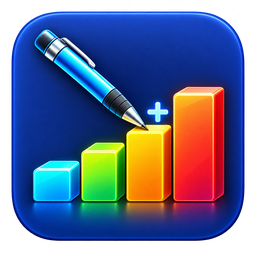
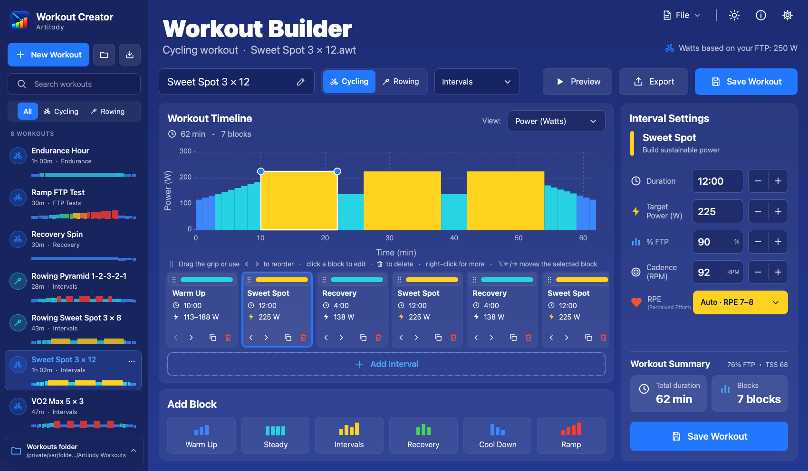
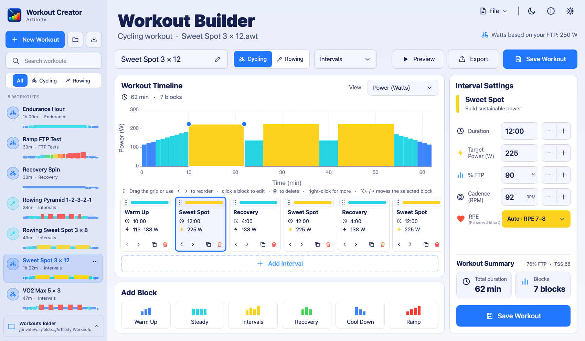
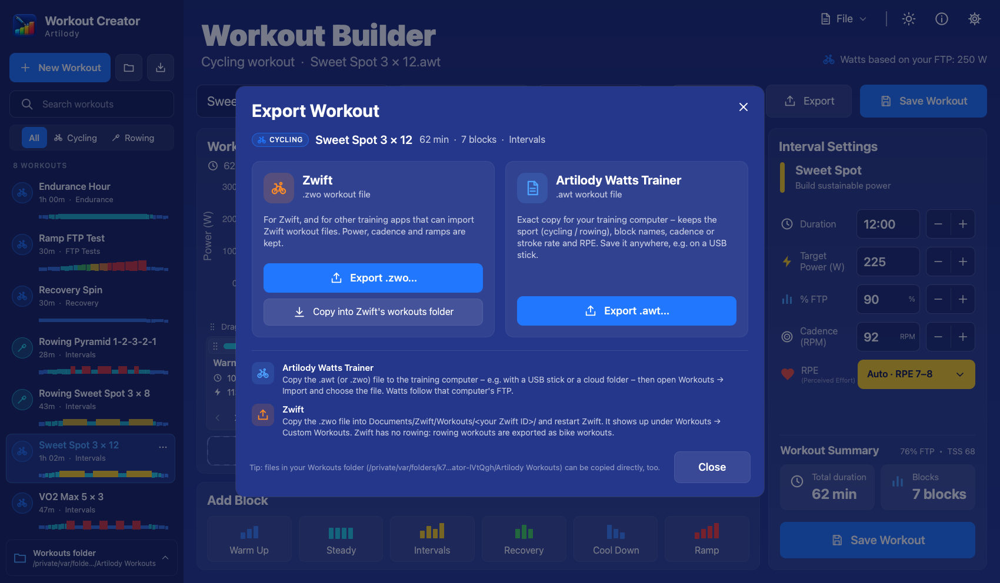

<div align="center">



# Artilody Workout Creator

**Create Artilody (`.awt`) and Zwift (`.zwo`) cycling & rowing workouts on any computer.**

[](https://github.com/shenphenchoedron-hue/Artilody-Workout-Creator/releases/latest)
[](LICENSE)

[](https://github.com/shenphenchoedron-hue/Artilody-Workout-Creator/actions/workflows/release.yml)


[**Download**](#download) · [Features](#features) · [Using your workouts](#using-your-workouts) · [Building from source](#building-from-source)

</div>

<p align="center">
  
</p>

Artilody Workout Creator is a small, free desktop app for designing structured indoor workouts. It has the
**same Workout Builder as [Artilody Watts Trainer](https://github.com/shenphenchoedron-hue/Artilody-Watts-Trainer)**
– the same block cards, chart, interval settings, drag-to-reorder, right-click menu and keyboard shortcuts – but
needs no trainer, no Bluetooth and no database. Every workout is a plain file, so you can plan your training on a
laptop and take the workouts to your training computer or to Zwift.

## Features

- **The Artilody Workout Builder** – Warm Up, Steady, Intervals, Recovery, Cool Down and Ramp blocks. Set
  duration, power in **% of FTP** (so the workout scales to every rider's FTP; watts are shown as a hint), ramps
  (start → end power), cadence (rowing: stroke rate in SPM) and RPE for every block.
- **Interval sets** – *Intervals* asks for the number of repeats, interval time and % FTP and recovery time and
  % FTP, e.g. 5 × 30 s @ 120 % with 1 min recovery @ 55 %.
- **Ramps and staircases** – *Ramp / Steps* builds a rising or falling staircase (number of steps, time per step,
  first and last step in % FTP) or one smooth ramp; every step stays editable on its own.
- **Easy reordering** – drag a block by its ⋮⋮ grip strip (with a drop indicator and auto-scroll), use the
  **‹ ›** buttons on each card, the **right-click menu** (*Move earlier / later / to start / to end, Duplicate,
  Delete interval*) or <kbd>Alt</kbd>/<kbd>⌥</kbd> + <kbd>←</kbd>/<kbd>→</kbd>.
- **Several blocks at once** – <kbd>Ctrl</kbd>/<kbd>⌘</kbd>-click, <kbd>Shift</kbd>-click or
  <kbd>Ctrl</kbd>/<kbd>⌘</kbd>+<kbd>A</kbd> selects several blocks to move, duplicate or delete together; changes
  in *Interval Settings* then apply to all of them.
- **Cycling and rowing** – a *Cycling / Rowing* switch stores the sport with the workout; rowing workouts are
  % of your rowing FTP.
- **FTP preview** – enter your cycling FTP, rowing FTP and default cadence to see real watts while you edit. The
  workout chart switches between watts and % FTP, **Preview** shows the whole workout as a zone-coloured chart with
  duration, average intensity (% FTP) and estimated TSS. Workouts are always saved relative to FTP, so they fit every rider.
- **File library** – every workout in your Workouts folder (default `~/Documents/Artilody Workouts`, changeable)
  is listed with name, sport, duration, category and a mini power profile; search, filter by sport, and the list
  refreshes automatically when files change.
- **Import & export** – open/import `.awt` and Zwift `.zwo` files (multi-workout files are split), export `.awt`
  or `.zwo` anywhere (e.g. a USB stick), and **Copy into Zwift's workouts folder** with one click when Zwift is
  installed. **Export all** writes every workout (or the ones matching your search / filter) in one go – one
  `.zwo` or `.awt` file each – e.g. a whole training series. *Duplicate*, *Rename*, *Delete* (to the trash) and
  *Show in Finder / Explorer* are built in.
- **Unsaved-changes protection** – the title and list mark edited workouts, and closing the app, opening another
  workout or starting a new one asks *Save / Don't Save / Cancel*.
- **Dark and light theme**, keyboard shortcuts, native file dialogs and high-DPI rendering.

<p align="center">
  
  
</p>

### Keyboard shortcuts

| Action | Windows / Linux | macOS |
|---|---|---|
| New cycling workout | <kbd>Ctrl</kbd>+<kbd>N</kbd> | <kbd>⌘</kbd><kbd>N</kbd> |
| New rowing workout | <kbd>Ctrl</kbd>+<kbd>Shift</kbd>+<kbd>N</kbd> | <kbd>⇧</kbd><kbd>⌘</kbd><kbd>N</kbd> |
| Open… | <kbd>Ctrl</kbd>+<kbd>O</kbd> | <kbd>⌘</kbd><kbd>O</kbd> |
| Save | <kbd>Ctrl</kbd>+<kbd>S</kbd> | <kbd>⌘</kbd><kbd>S</kbd> |
| Save As… | <kbd>Ctrl</kbd>+<kbd>Shift</kbd>+<kbd>S</kbd> | <kbd>⇧</kbd><kbd>⌘</kbd><kbd>S</kbd> |
| Export | <kbd>Ctrl</kbd>+<kbd>E</kbd> | <kbd>⌘</kbd><kbd>E</kbd> |
| Import | <kbd>Ctrl</kbd>+<kbd>I</kbd> | <kbd>⌘</kbd><kbd>I</kbd> |
| Search workouts | <kbd>Ctrl</kbd>+<kbd>F</kbd> | <kbd>⌘</kbd><kbd>F</kbd> |
| Settings | <kbd>Ctrl</kbd>+<kbd>,</kbd> | <kbd>⌘</kbd><kbd>,</kbd> |
| Export all workouts | <kbd>Ctrl</kbd>+<kbd>Shift</kbd>+<kbd>E</kbd> | <kbd>⇧</kbd><kbd>⌘</kbd><kbd>E</kbd> |
| Select all blocks | <kbd>Ctrl</kbd>+<kbd>A</kbd> | <kbd>⌘</kbd><kbd>A</kbd> |
| Move selected block(s) earlier / later | <kbd>Alt</kbd>+<kbd>←</kbd> / <kbd>→</kbd> | <kbd>⌥</kbd><kbd>←</kbd> / <kbd>→</kbd> |

## Download

Version **1.1.1** – all files are on the [release page](https://github.com/shenphenchoedron-hue/Artilody-Workout-Creator/releases/latest).

| Platform | Download |
|---|---|
| **Windows 10/11** (64-bit) – installer | [ArtilodyWorkoutCreator-1.1.1-windows-x64-setup.exe](https://github.com/shenphenchoedron-hue/Artilody-Workout-Creator/releases/download/v1.1.1/ArtilodyWorkoutCreator-1.1.1-windows-x64-setup.exe) |
| **Windows 10/11** (64-bit) – portable ZIP | [ArtilodyWorkoutCreator-1.1.1-windows-x64.zip](https://github.com/shenphenchoedron-hue/Artilody-Workout-Creator/releases/download/v1.1.1/ArtilodyWorkoutCreator-1.1.1-windows-x64.zip) |
| **macOS 12+** (Apple Silicon & Intel, universal) | [ArtilodyWorkoutCreator-1.1.1-macOS-universal.dmg](https://github.com/shenphenchoedron-hue/Artilody-Workout-Creator/releases/download/v1.1.1/ArtilodyWorkoutCreator-1.1.1-macOS-universal.dmg) |
| **Debian 12** Bookworm (amd64) | [artilody-workout-creator_1.1.1_debian12_amd64.deb](https://github.com/shenphenchoedron-hue/Artilody-Workout-Creator/releases/download/v1.1.1/artilody-workout-creator_1.1.1_debian12_amd64.deb) |
| **Ubuntu 24.04** LTS (amd64) | [artilody-workout-creator_1.1.1_ubuntu24.04_amd64.deb](https://github.com/shenphenchoedron-hue/Artilody-Workout-Creator/releases/download/v1.1.1/artilody-workout-creator_1.1.1_ubuntu24.04_amd64.deb) |
| **Raspberry Pi OS** 64-bit Bookworm (arm64, Pi 3/4/5/400) | [artilody-workout-creator_1.1.1_raspberrypi-os-bookworm_arm64.deb](https://github.com/shenphenchoedron-hue/Artilody-Workout-Creator/releases/download/v1.1.1/artilody-workout-creator_1.1.1_raspberrypi-os-bookworm_arm64.deb) |
| Checksums | [SHA256SUMS.txt](https://github.com/shenphenchoedron-hue/Artilody-Workout-Creator/releases/download/v1.1.1/SHA256SUMS.txt) |

### Installation

**Windows** – run the setup (Start menu entry, optional desktop shortcut), or extract the ZIP and start
`Artilody Workout Creator.exe`. The app is not code-signed yet, so SmartScreen may show *"Windows protected your
PC"*: click **More info → Run anyway**.

**macOS** – open the DMG and drag **Artilody Workout Creator** onto **Applications**. The app is ad-hoc signed but
not notarized: the **first time, right-click (Control-click) the app → Open → Open**. If macOS still refuses
(“damaged”), run once:

```sh
xattr -cr "/Applications/Artilody Workout Creator.app"
```

**Debian 12 / Ubuntu 24.04 / Raspberry Pi OS** – install the matching `.deb` with apt (it pulls in the Qt 6
libraries):

```sh
sudo apt install ./artilody-workout-creator_1.1.1_debian12_amd64.deb                # Debian 12
sudo apt install ./artilody-workout-creator_1.1.1_ubuntu24.04_amd64.deb             # Ubuntu 24.04
sudo apt install ./artilody-workout-creator_1.1.1_raspberrypi-os-bookworm_arm64.deb # Raspberry Pi OS 64-bit
```

Start it from the application menu or run `artilody-workout-creator`. Uninstall with
`sudo apt remove artilody-workout-creator`. Older distributions with Qt < 6.4 (e.g. Ubuntu 22.04) and 32-bit
Raspberry Pi OS are not supported.

**Verify a download** (Linux / macOS / Git Bash):

```sh
sha256sum -c SHA256SUMS.txt --ignore-missing     # macOS: shasum -a 256 -c SHA256SUMS.txt --ignore-missing
```

## Using your workouts

Workouts are stored **relative to FTP**, so they scale to whoever rides them. The FTP in the creator's settings
only changes the watts you see while editing.

### In Artilody Watts Trainer

1. Copy the `.awt` file to your training computer (USB stick, cloud folder, e-mail …) – use **Export → Export
   .awt…** or take it straight from your Workouts folder.
2. In Artilody Watts Trainer open **Workouts → Import** and pick the file. The workout appears in your library
   with its sport (cycling/rowing), block names, cadence/stroke rate and RPE.

Artilody Watts Trainer imports `.zwo` files as well.

### In Zwift

1. Use **Export → Export .zwo…**, or **Copy into Zwift's workouts folder** when Zwift is installed on the same
   computer.
2. The file belongs in `Documents/Zwift/Workouts/<your Zwift ID>/` (the numbered folder). Restart Zwift.
3. The workout is listed under **Workouts → Custom Workouts**.

Zwift only knows bike and run workouts, so **rowing workouts are exported as bike workouts** (the % FTP blocks are
kept, the sport is not).

### File formats

- **`.awt`** – Artilody's native format: UTF-8 JSON with `"format": "artilody-watts-trainer/workout"`, version 1.
  It keeps everything (sport, block names, ramps, cadence/stroke rate, RPE). It is written by exactly the same
  code as Artilody Watts Trainer's own export (`shared/src/core/WorkoutIO`). Each file in the Workouts folder
  holds one workout; files with several workouts are split on import.
- **`.zwo`** – Zwift's XML workout format. Power, ramps, intervals and cadence are kept; block names, RPE and the
  sport are lost.

## Building from source

Requirements: CMake ≥ 3.21, a C++17 compiler and **Qt ≥ 6.4** (Core, Gui, Qml, Quick, QuickControls2; Qt Test
for the unit tests). No QtSql, QtBluetooth or QtMultimedia needed.

```sh
git clone https://github.com/shenphenchoedron-hue/Artilody-Workout-Creator.git
cd Artilody-Workout-Creator
```

**macOS**

```sh
cmake -S . -B build -DCMAKE_PREFIX_PATH=$HOME/Qt/6.8.3/macos -DCMAKE_BUILD_TYPE=Release
cmake --build build -j8
ctest --test-dir build --output-on-failure
open "build/Artilody Workout Creator.app"
packaging/macos/make_dmg.sh $HOME/Qt/6.8.3/macos     # optional: deployed, ad-hoc signed app + DMG in dist/
```

**Windows** (Developer Command Prompt for VS 2022)

```bat
cmake -S . -B build -G Ninja -DCMAKE_BUILD_TYPE=Release -DCMAKE_PREFIX_PATH=C:\Qt\6.8.3\msvc2022_64
cmake --build build
ctest --test-dir build --output-on-failure
windeployqt --qmldir qml --qmldir shared\qml "build\Artilody Workout Creator.exe"
```

**Debian 12 / Ubuntu 24.04 / Raspberry Pi OS**

```sh
sudo apt install build-essential cmake ninja-build qt6-base-dev qt6-declarative-dev qt6-qpa-plugins \
     qml6-module-qtquick qml6-module-qtquick-controls qml6-module-qtquick-layouts \
     qml6-module-qtquick-dialogs qml6-module-qtquick-window qml6-module-qtquick-templates \
     qml6-module-qtqml-workerscript qml6-module-qtqml-models
cmake -S . -B build -G Ninja -DCMAKE_BUILD_TYPE=Release
cmake --build build
ctest --test-dir build --output-on-failure
(cd build && cpack -G DEB)                # optional: build/artilody-workout-creator_<version>_<arch>.deb
```

Release packages are built by [`.github/workflows/release.yml`](.github/workflows/release.yml) on every `v*`
tag (Windows installer + ZIP, macOS universal DMG, Debian/Ubuntu/Raspberry Pi `.deb`s, `SHA256SUMS.txt`).

**Developer notes**

- `WATT_SCREENSHOT_DIR=<dir>` (with `QT_QPA_PLATFORM=offscreen`) starts with temporary settings and a temporary
  Workouts folder full of demo workouts, saves screenshots of several views and quits – it never touches your
  own files. `packaging/ci/smoke-test.sh` uses it in CI.
- `AWC_SETTINGS_FILE=<file.ini>` and `AWC_WORKOUTS_DIR=<dir>` override the settings store and the Workouts folder.
- `tools/make_icon.py` (Pillow) regenerates all icons from `assets/icons/creator-icon-source.png`.

## Relation to Artilody Watts Trainer

[Artilody Watts Trainer](https://github.com/shenphenchoedron-hue/Artilody-Watts-Trainer) is the full training
app (smart trainer ERG control, Concept2 PM5 rowing, heart rate, calendar, history, FIT export). This creator is
its stand-alone workout editor.

The workout model, the Builder back-end, the `.awt`/`.zwo` code and the Builder page/UI components are **shared
code from Artilody Watts Trainer** (GPL-3.0), vendored unchanged into [`shared/`](shared/) with the same layout
(`shared/src/core/…`, `shared/qml/…`). Don't edit them here: change them in Artilody Watts Trainer and refresh the
copy with `tools/sync_shared.sh <this checkout> <Artilody Watts Trainer checkout>`. CMake finds the shared code via
the `ARTILODY_SHARED_DIR` cache variable – it defaults to `shared/` here, and to the parent folder when the creator
is built inside the Artilody Watts Trainer repository (`Artilody Workout Creator/`).

| Shared (from Artilody Watts Trainer, `shared/`) | Creator only |
|---|---|
| `src/core`: `Workout`, `Interval`, `Zones`, `TimeFormat`, `WorkoutIO`, `WorkoutBuilder`, `BuilderBackend.h` | `src/`: `WorkoutFileLibrary`, `CreatorBackend`, `CreatorSettings`, `DemoWorkouts`, `main.cpp` |
| `qml`: `Theme.qml`, `pages/BuilderPage.qml`, `dialogs/ConfirmDialog.qml`, `dialogs/RampDialog.qml`, `dialogs/IntervalSetDialog.qml`, 22 `components/` | `qml/`: `Main`, `LibraryPanel`, `LibraryItem`, `CreatorTopBar`, `ExportDialog`, `CreatorSettingsDialog`, `RenameDialog`, `HelpDialog`, `UsageNote` |

## License

Artilody Workout Creator is free software, licensed under the **GNU General Public License v3.0** – see
[LICENSE](LICENSE). The shared code in `shared/` comes from Artilody Watts Trainer under the same license.
Zwift is a trademark of Zwift, Inc.; Concept2 is a trademark of Concept2, Inc. This project is not affiliated
with either.
